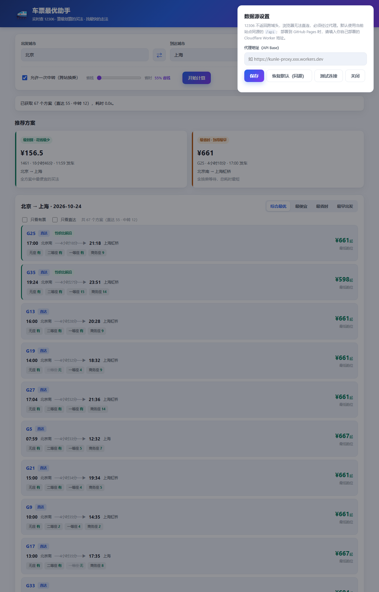

# 🚄 车票最优助手（kunle）

> 把 12306 的车次截图粘进去，自动算出**最划算的买法**和**最省时的走法**。

不上传、不抓取、不登录。截图在你本机用 Windows 自带的 OCR 引擎识别，方案计算全部在浏览器里完成 —— 工具只做一件事：**在你给的车次里，找出价格与时间的最优组合。**



---

## 目录

- [为什么这样设计](#为什么这样设计)
- [它是怎么工作的](#它是怎么工作的)
- [功能清单](#功能清单)
- [快速开始](#快速开始)
- [项目结构](#项目结构)
- [接口说明](#接口说明)
- [算法说明](#算法说明)
- [测试](#测试)
- [代码规模](#代码规模)
- [已知限制](#已知限制)

---

## 为什么这样设计

买火车票有两个常见纠结：

1. **怎么买最划算？** 直达票往往不是最便宜的。北京→上海直达二等座 553 元，而「北京→南京 + 南京→上海」两程合计可能更便宜、甚至更早到。人肉比价几乎不可能。
2. **怎么走最省时？** 车次表只给单趟历时，不告诉你换乘要等多久、总耗时多少。

早期版本曾直接调用 12306 查询接口，但 12306 的用户协议明确禁止自动化抓取，接口也布有反爬机制。**这个版本把数据来源交还给你**：你自己从官方 App 截图，工具在本地识别、本地计算。既不违反条款，也不需要任何账号或 API Key。

---

## 它是怎么工作的

```
你的截图 ──► 本机 Node 服务 ──► Windows.Media.Ocr（离线中文识别）
                                      │
                                      ▼
                        解析成车次表格（可人工核对修改）
                                      │
                    ┌─────────────────┼─────────────────┐
                    ▼                 ▼                 ▼
              数据校验          行程链组合          加权打分
           (validate.js)       (algo.js)         (algo.js)
                    │                 │                 │
                    └─────────────────┼─────────────────┘
                                      ▼
                 最划算 / 最省时 / 综合最优 / Pareto 前沿
                                      │
                    ┌─────────────────┼─────────────────┐
                    ▼                 ▼                 ▼
              散点图(chart)    时间轴(timeline)    报告(report)
```

| 环节 | 实现 | 是否联网 |
|---|---|---|
| 截图 → 文字 | Windows 自带 `Windows.Media.Ocr`（与系统截图工具提取文字同款引擎） | ❌ 完全离线 |
| 文字 → 车次表格 | `assets/parse.js`：按坐标聚类成行、容错修正 OCR 错字（`G1`→`GI`、`598.0`→`598·0`） | ❌ |
| 数据校验 | `assets/validate.js`：时间格式、历时自洽、票价异常、站点衔接、重复录入 | ❌ |
| 方案计算 | `assets/algo.js`：行程链组合 + 归一化加权 + Pareto 支配 | ❌ |
| 可视化与导出 | `chart.js` / `timeline.js` / `report.js` | ❌ |

**不会发生的事**：不请求 12306、不上传你的截图、不收集任何信息。

---

## 功能清单

### 数据录入

- 📷 **截图识别**：点击选择 / 拖拽 / `Ctrl+V` 粘贴，识别车次、时刻、历时、票价、余票
- 📐 **两种版式自动适配**：横排表格截图按行聚类；手机 App 的竖排卡片截图按车次号切段（两种策略都跑，自动选更完整的那份）
- ⚡ **识别完直接算**：解析出可用数据后自动计算方案，不用再点按钮
- 🔍 **识别原文面板**：识别不准时可展开查看原始文字，并一键复制改用「粘贴文本」
- ✏️ **表格可编辑**：OCR 难免错字，结果直接进表格，改完再算
- 📋 **粘贴文本**：每行一趟车，字段顺序随意，自动识别
- 📥 **CSV 导入 / 导出**：兼容中英文表头，导出带 BOM 可直接用 Excel 打开
- 🧪 **示例数据**：`?demo=1` 一键载入

### 计算能力

- 🚄 **最多两次中转**：直达 / 一次中转 / 两次中转，逐层扩展并做组合剪枝
- ⏱ **换乘时间校验**：可设最少换乘分钟与最长等待，超出的组合直接淘汰
- 🏷 **三类结论**：最划算（总价最低）、最省时（含等待的最短总耗时）、综合最优（权重加权）
- 📈 **Pareto 前沿**：标出「没有被任何方案在更便宜和更快上同时压制」的方案
- 🎚 **权重滑块**：在「省钱 ↔ 省时」之间滑动，推荐实时重算
- 💡 **自动洞察**：直接告诉你「比最便宜直达省多少 / 多花多少时间」「每小时省多少钱」

### 分析与管理

- 📊 **散点图**：价格 × 耗时分布，悬停看明细，点击选中，绿色虚线是前沿
- 📏 **时间轴**：单方案分段可视化，乘车与等待按真实时长占比排布
- 🧹 **条件筛选**：席别、发车时段、票价上限、耗时上限、最多中转次数、排除跨夜
- 🕘 **历史记录**：本地保存最近 20 次计算，可一键回填
- 📄 **报告导出**：Markdown / HTML 报告，含推荐、洞察与明细表
- 🖨 **打印方案单**：专门的打印样式，一页一单
- 🌗 **主题切换**：跟随系统 / 浅色 / 深色
- ♿ **无障碍**：全键盘操作、屏幕阅读器播报、弹窗焦点陷阱、选项卡方向键切换

### 快捷键

| 快捷键 | 作用 |
|---|---|
| `Ctrl` + `Enter` | 计算最优方案 |
| `Ctrl` + `E` | 导出 Markdown 报告 |
| `Ctrl` + `P` | 打印方案单 |
| `Alt` + `1~4` | 切换排序（综合 / 最便宜 / 最省时 / 最早出发） |
| `Alt` + `D` | 载入示例数据 |
| `Esc` | 关闭行程详情 |

---

## 快速开始

需要 Node.js 18+ 与 Windows 10/11（自带中文 OCR）。

```bash
git clone https://github.com/Kunle78778/kunle.git
cd kunle
node server/server.mjs
```

打开 <http://127.0.0.1:8787>，然后：

1. 从 12306 官方 App 截一张车次列表图（保证「车次 + 发到时间 + 票价」在同一行）；
2. 按 `Ctrl+V` 粘贴，或拖进虚线框；
3. 表格里核对、修正识别结果（有问题会在「数据检查」里标出）；
4. 点「计算最优方案」。

想先看效果：打开 <http://127.0.0.1:8787/?demo=1>。

### 手机怎么用

手机用移动数据时 **github.io 在国内通常打不开**（域名被阻断，不是网站挂了）。三种可行方式：

| 方式 | 能做什么 | 步骤 |
|---|---|---|
| **① 同一 WiFi 访问电脑**（功能最全，含截图识别） | 全部功能 | 手机连与电脑相同的 WiFi，浏览器打开终端里打印的「手机:」地址，例如 `http://192.168.111.145:8787`。首次需在 Windows 防火墙弹窗里点「允许」 |
| **② 单文件离线版**（外出/流量可用） | 除截图 OCR 外全部功能 | 用微信/QQ 把仓库根目录的 [`standalone.html`](standalone.html) 发到手机，用浏览器打开即可 |
| **③ 手机挂代理** | 线上完整版 | 手机安装 Clash 等客户端，连同一订阅后访问 GitHub Pages 地址 |

> 单文件版由 `npm run build` 生成（把 CSS/JS 全部内联成一个 158KB 的 HTML）。
> 它打开后顶部会显示「离线版」，截图区域会置灰——因为 OCR 依赖本机 Windows 服务，手机上没有。

局域网访问还需要放行端口（管理员 PowerShell 执行一次）：

```powershell
netsh advfirewall firewall add rule name="kunle-ticket-8787" dir=in action=allow protocol=TCP localport=8787
```

### 没有 OCR 也能用

- 直接「粘贴文本」：每行一趟车，字段顺序随意
  ```
  G1 北京南 上海虹桥 06:30 11:24 04时54分 二等座 有 ¥598.0
  G531 北京南 上海虹桥 06:08 12:04 05时56分 二等座 2 ¥498.0
  ```
- 或「导入 CSV」、手动「+ 添加一行」。
- 部署到 GitHub Pages 这类纯静态环境时，只有截图识别不可用（需要本机服务），粘贴文本、CSV、全部计算与可视化照常工作。

---

## 项目结构

```
kunle/
├── index.html              页面结构
├── manifest.json           PWA 清单
├── sw.js                   Service Worker（离线缓存）
├── assets/
│   ├── styles.css          样式（深色模式 / 响应式 / 打印）
│   ├── parse.js            OCR 文本与 CSV → 车次行
│   ├── algo.js             行程链组合、筛选、评分、Pareto、统计
│   ├── validate.js         数据校验（错误 / 警告 / 提示）
│   ├── chart.js            Canvas 价格-耗时散点图
│   ├── timeline.js         行程时间轴（SVG）
│   ├── report.js           自动洞察 + Markdown / HTML 报告
│   ├── store.js            本地设置与历史（localStorage）
│   ├── a11y.js             快捷键、播报、焦点陷阱、roving tabindex
│   ├── app.js              界面控制器
│   └── icon.svg            应用图标
├── server/
│   ├── server.mjs          静态托管 + POST /api/ocr
│   └── ocr.ps1             Windows OCR 调用脚本
├── tests/                  132 个单元测试
└── package.json
```

---

## 接口说明

本地服务只有两个端点：

| 端点 | 说明 |
|---|---|
| `GET /api/health` | 返回 `{ ok, ocr }`，用于页面显示引擎状态 |
| `POST /api/ocr` | 请求体为图片二进制（≤12MB），返回识别出的文字行及坐标 |

`POST /api/ocr` 返回示例：

```json
{
  "ok": true,
  "width": 1680,
  "height": 640,
  "lines": [
    { "text": "G1", "x": 50, "y": 73, "w": 51, "h": 44 },
    { "text": "06：30", "x": 247, "y": 75, "w": 90, "h": 44 }
  ]
}
```

---

## 算法说明

### 综合最优

价格与总耗时分别归一化到 `[0,1]`：

```
价格分 = (price - minPrice) / (maxPrice - minPrice)
时间分 = (duration - minDuration) / (maxDuration - minDuration)
综合分 = 权重 × 价格分 + (1 - 权重) × 时间分      ← 越小越好
```

权重由滑块给出：100 表示只看钱，0 表示只看时间。

### Pareto 前沿

方案 A 支配方案 B，当且仅当 A 同时满足 `价格 ≤ B`、`时间 ≤ B`，且至少一项严格小于。不被任何方案支配的即为前沿方案。

### 行程链组合

```
分组语义：graph[0]=直达（只做单段），graph[1..3]=第一/二/三程
逐层扩展：从第一程开始，每次尝试接下一程
等待时间 = 下一程发车 − 上一程到达（跨夜自动 +24h）
可行条件 = 最少换乘 ≤ 等待 ≤ 最长等待
剪枝：每层按累计耗时排序，只保留前 120 个组合
```

### 复杂度控制

三程全排列最坏是 `N₁×N₂×N₃`。为避免爆炸，每层只保留累计耗时最短的 120 个中间结果，最终方案上限 800 个；实际使用（每程 10~50 趟）通常在毫秒级完成。

---

## 测试

```bash
npm test          # 单元测试：node --test
npm run qa        # 端到端冒烟测试：需要先启动本地服务
```

### 单元测试（132 个用例）

| 文件 | 覆盖内容 |
|---|---|
| `tests/algo.test.mjs` | 时间换算、跨夜、行程链、换乘约束、剪枝、筛选、评分、Pareto、统计 |
| `tests/parse.test.mjs` | 全角归一化、车次修正、字段抽取、OCR 行聚类、文本解析 |
| `tests/csv.test.mjs` | 导入导出往返、表头别名、转义、无表头兜底 |
| `tests/store.test.mjs` | 设置读写、历史增删与上限、导入导出、非法输入 |
| `tests/validate.test.mjs` | 各类错误/警告规则、跨行检查、严重度排序 |
| `tests/report.test.mjs` | 洞察生成、Markdown/HTML 结构、转义 |
| `tests/timeline.test.mjs` | 片段拆分、宽度分配、SVG 生成、与算法联动 |

### 端到端冒烟测试（20 项）

`tools/qa.mjs` 不依赖 puppeteer：它启动无头 Chrome，通过 **DevTools Protocol** 真实点击控件并断言 DOM，同时收集未捕获异常与 `console.error`。覆盖：渲染、筛选、权重排序、行程详情开关、Esc 关闭、散点图绘制、排序、历史、设置持久化、主题、CSV 往返、报告生成、数据校验、空状态、Service Worker 版本。

> 这也是排查「按钮点了没反应」「弹层关不掉」这类问题的抓手：多数情况是新旧资源混用，脚本绑定了已经不存在的元素。


---

## 代码规模

| 指标 | 数值 |
|---|---|
| 文件数 | 25 |
| 总行数 | 约 6290 |
| 有效代码行 | 约 5150 |
| 单元测试 | 132 个用例，全部通过 |

（统计脚本见提交历史；`.gitignore` 已排除 `node_modules` 等目录。）

---

## 已知限制

1. **OCR 不是 100% 准确**：字体太小、压缩过度时可能认错。识别结果进表格后需核对，这是设计的一部分。
2. **需要 Windows**：OCR 依赖 `Windows.Media.Ocr` 与中文语言包；macOS/Linux 上只能用粘贴文本或 CSV。
3. **最多两次中转**：三次及以上换乘的组合数不划算。
4. **票价需你提供**：工具不查价，价格来自你的截图或输入。
5. **不校验真实性**：算法只做优化，不验证车次是否存在、是否已售完。
6. **中转需分段购票**：第二程可能售罄，请以 12306 实际余票为准。

### 关于 Service Worker 缓存

页面注册了 Service Worker 以支持离线与安装。**升级后如果界面表现异常（按钮无反应、面板关不掉），几乎都是缓存了旧版页面。**

现已改为：

- HTML / JS / CSS 一律**网络优先**，离线才回退缓存；
- 每次发版提升 `sw.js` 里的 `VERSION`，激活时删除全部旧缓存；
- 页面启动时比对 `version.json`，发现浏览器还在跑旧版就自动清缓存更新；
- 头部提供 **⟳ 清除缓存并更新** 按钮；
- 静态资源带 `?v=版本号`，绕过 `max-age=600` 的 HTTP 缓存。

### 界面还是旧版 / 按钮没反应？

打开这个地址一次即可，它不依赖任何被缓存的资源：

```
https://kunle78778.github.io/kunle/reset.html
```

它会注销 Service Worker、删除全部缓存，然后跳转到最新版。页面底部的 `vX.Y.Z` 是当前构建号，可用来确认是否已经更新。

> 本地使用时同理：`http://127.0.0.1:8787/reset.html`

手动清理也行：开发者工具 → Application → Service Workers → Unregister → 硬刷新（`Ctrl` + `F5`）。


---

## 免责声明

本工具不访问 12306 或任何第三方服务，全部数据由使用者本机提供。车次、票价与余票请以 [12306 官网](https://www.12306.cn) 或官方 App 为准。本项目仅供学习交流。

---

## License

MIT
